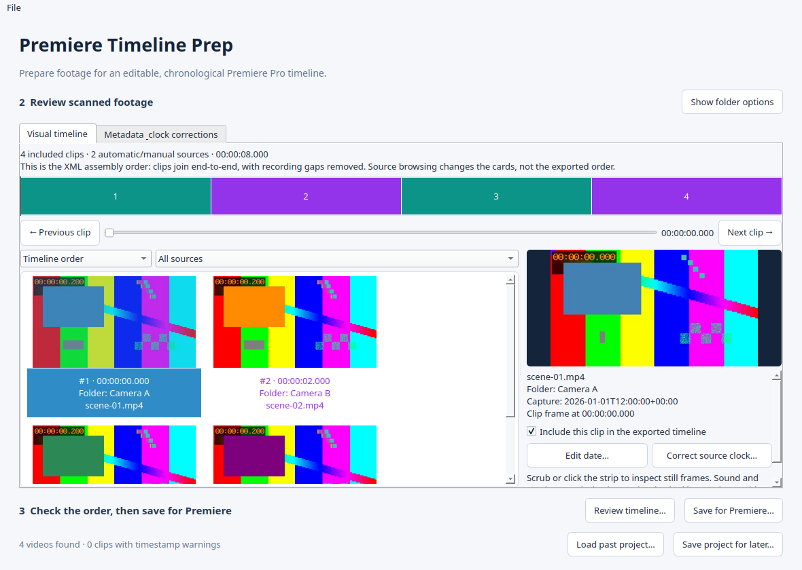

# Premiere Timeline Prep

Review video recording dates, correct camera clocks, and export a chronological
assembly for Adobe Premiere Pro. Media stays in its original location and is not
edited or transcoded.

**Experimental:** XML export has automated structure/timing tests but has not yet
been verified in Premiere. Check picture, sound, and sync before using it for an edit.



## Run on Windows

For private development, run the build workflow manually and download its **tested** Windows artifact from
[GitHub Actions](https://github.com/nritsche/PremiereTimelinePrep/actions), unzip the
whole package, and run `PremiereTimelinePrep.exe`. Keep its `_internal/` folder beside it; the portable app is no longer a single-file bundle. FFmpeg (for images), FFprobe and ExifTool are bundled;
Python is not needed. Keep the included notices, manifest and checksums with the
executable. Experimental private development artifacts are not a reviewed public release. Automatic pushes do not upload unreviewed executables. Private manual builds can upload development artifacts; public binary uploads are disabled until the maintainer enables them after the distribution review.

Versioned downloads will be available on the repository's Releases page after the
[distribution review](docs/RELEASE_CHECKLIST.md) is complete. Builds are unsigned;
verify their origin and checksum rather than disabling security software.

## Scan, review, export

1. **Add folders.** Choose whether to include subfolders and which video formats to scan.
2. **Choose camera timezone.** Use the timezone your cameras used for dates without an explicit offset, e.g. `Europe/Madrid`. UTC is the default. Dates containing an offset keep it; all displayed times are UTC. If cameras used different timezones, correct each camera group after scanning.
3. **Scan folders.** The app reads metadata in the background. Cancel scan or close the app to stop; a cancelled or failed scan retains the previous review.
4. **Review the visual timeline.** Large clip images show the assembled order. Click the duration strip or drag its slider to inspect still frames across the sequence; use Previous/Next to inspect adjacent clips. Clip numbers and sequence positions follow XML export, including its frame rounding. This previews picture order with still frames; continuous playback, audio and Premiere interpretation still need checking in Premiere.
5. **Browse automatic sources and correct clocks.** Camera make/model and serial metadata supply source labels where available. Otherwise **Folder:** groups use the media's folder (standard camera-card directories are skipped). Folder labels do not confirm camera identity; cameras of the same model may share a label when no serial is available. **Browse by camera / source** includes excluded clips so you can restore them. Use **Edit date…** or **Correct source clock…** to fix timing. The **Metadata & clock corrections** tab retains full timestamp candidates and manual grouping. Confidence is a ranking heuristic, not proof that a camera clock was correct.
6. **Check inclusion and order.** Uncheck **Include this clip** for unwanted footage. **Review timeline…** and **Save for Premiere…** open the same visual assembly. Source browsing and table filters do not change export order. Unknown dates go last; ties use filename and full path. Images are decoded on demand, kept only in a bounded memory cache and never written to session reports. Missing media/decoder failures are shown explicitly.
7. **Save project for later…** saves original candidates, corrections, groups, inclusion choices and metadata as a reloadable JSON project. **Load past project…** resumes it without rescanning, including projects saved by older versions. The title marks unsaved review work; opening, rescanning or closing offers Save/Discard/Cancel. **File → Export report (JSON / CSV)…** retains audit/inventory export; CSV cannot restore a project.
8. **Save for Premiere…** opens the timeline review before asking where to save the Premiere-importable XML. Clips are placed back-to-back: recording-time gaps are removed. This is an interchange timeline, not a native `.prproj` file. If rates need approximation, the explanation and scrollable details show why; check playback and audio sync after importing into Premiere. The review content and long save errors scroll while action buttons remain fixed below them.

## Supported media and limits

- Discovery supports `.mp4`, `.mov`, `.m4v`, `.avi`, `.mkv`, `.mts`, `.m2ts`, `.3gp` and `.webm`. Recognition does not guarantee Premiere can decode the codec.
- Overlapping folders and hard links are deduplicated. Unavailable folders produce scan errors rather than replacing a review with an empty result.
- XML is Final Cut Pro 7 `xmeml` version 5, based on [Apple's encoding documentation](https://developer.apple.com/library/archive/documentation/AppleApplications/Reference/FinalCutPro_XML/Basics/Basics.html). It is distinct from `.fcpxml`, which [Premiere cannot directly import](https://helpx.adobe.com/ca/premiere/desktop/organize-media/import-files/migrate-from-final-cut-pro-x.html).
- Sequence settings follow the first included clip. Supported audio channels are linked on separate tracks. The exporter requires current stream metadata; reopen old reports for review, then rescan before exporting XML when requested.
- Multiple video/audio streams, rotation, non-square pixels, interlacing, significant stream start offsets, and mismatched video/container durations are rejected rather than silently exported incorrectly. Use a normalized copy or exclude those clips. Normalization is not implemented by this app.
- Variable-rate footage is not converted to constant rate. Export prefers a representable base-rate guess close to the average, otherwise a nearby common rate or nearest integer. Approximation notices appear before export and in the XML log. Boundary positions use cumulative elapsed duration; this does not prove frame accuracy or audio sync.
- Export destinations cannot be source media or its aliases. Reports/XML use absolute paths; moving media or using another computer requires relinking. Relinking inside this app is not implemented.
- JSON sessions have a 64 MB / 50,000 clip loading limit. Opening a saved session does not revalidate or reread the original media.

## Privacy

Scanning, review and export run locally; there is no telemetry or media upload.
JSON reports preserve raw metadata and absolute paths, potentially including names,
recording dates, GPS positions and device identifiers. XML also contains media
paths. Sanitize exports and screenshots before sharing them. Default `session-report*` and `timeline*` exports in the project root, and all
files in `exports/`, are ignored by Git. CSV neutralizes common formula
prefixes; JSON preserves the original values. See [SECURITY.md](SECURITY.md).

## Run from source

Use Python 3.11 or newer.

```bash
python3 -m venv .venv
. .venv/bin/activate
pip install -e '.[gui,dev]'
python -m app.main
```

On Windows, activate with `.venv\Scripts\Activate.ps1`, then run the same pip and
Python commands. On Ubuntu install metadata tools with:

```bash
sudo apt install ffmpeg libimage-exiftool-perl
```

Tools are detected from PATH when running from source. Missing tools are shown as
setup notices; durations and embedded dates may be incomplete. Scan again after
installing tools. Linux file-change time is not treated as file creation time.

Run tests with `python -m pytest -q`. CI checks Linux with Python 3.11–3.13 and
Windows with Python 3.12. GUI tests use the offscreen Qt platform.

## Windows builds and releases

The [Windows workflow](.github/workflows/build-windows.yml) pins Python build
packages and Chocolatey tool versions, runs tests, builds with PyInstaller, and
runs the **actual executable** against synthetic video/audio. Artifacts include
`self-test.json`, `build-manifest.json`, the full `distribution-inventory.json`, preserved upstream notices, and a SHA-256 checksum.
PyInstaller must run on Windows to produce a Windows executable.

To build locally on Windows:

```powershell
python -m pip install -r requirements-build.txt
python -m pip install --no-build-isolation --no-deps -e .
python scripts/build_windows.py --ffprobe C:\path\to\ffprobe.exe --ffmpeg C:\path\to\ffmpeg.exe --exiftool 'C:\path\to\exiftool(-k).exe'
python scripts/check_windows_bundle.py
```

Build output is `dist/PremiereTimelinePrep/`; the executable is inside that portable folder. The self-test needs FFmpeg on the build machine to generate synthetic media.
Release packages stage only the metadata executables, their required neighboring
DLLs/runtime files and notices. The manifest records versions and hashes; identical
binary output across rebuilds is not claimed.

Public downloads require a license/source distribution review. The manual
[draft-release workflow](.github/workflows/draft-release.yml) verifies a tested
artifact, corresponding-source checksum, and license materials, then creates a
**draft prerelease**, not a published release. See [third-party notices](THIRD_PARTY_NOTICES.md)
and the [release checklist](docs/RELEASE_CHECKLIST.md). The current
[third-party review evidence](docs/THIRD_PARTY_REVIEW.md) and [native dependency matches](docs/NATIVE_DEPENDENCIES.md) records what remains
unresolved. For private review builds, the manual workflow can collect primary
and matched native upstream sources and source-shipped notices; these are not automatic distribution
approval. [Library replacement instructions](docs/LIBRARY_REPLACEMENT.md) describe
the portable layout and rebuild path.

## Premiere import check

1. Create a test project and use **File → Import** to select the XML.
2. Verify the expected media and sequence appear, open the sequence, and check order, exclusions, links and sequence settings.
3. Play across boundaries and near the end of long clips. Check every audio channel, linked selection and sync, particularly for mixed or variable rates.
4. Compare duration with included footage, allowing frame rounding. Save, reopen and verify again; test relinking after moving media.
5. Record app/Premiere/Windows versions, warnings and results in [the validation record](docs/PREMIERE_VALIDATION.md). Use synthetic or licensed samples.

Report bugs using the repository's issue template. Do not attach unreviewed private
reports or footage. Development guidance is in [CONTRIBUTING.md](CONTRIBUTING.md).

## License

Original project code is licensed under the standard [MIT License](LICENSE).
Bundled third-party components retain their own terms; see
[THIRD_PARTY_NOTICES.md](THIRD_PARTY_NOTICES.md).
